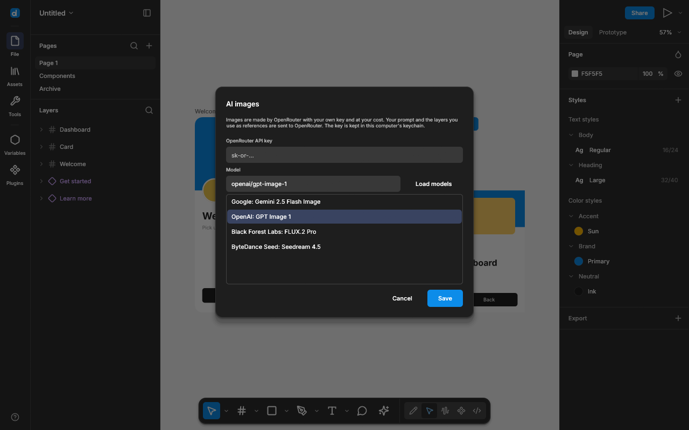

# AI images

desigma can generate images and edit parts of images with a model you choose on
[OpenRouter](https://openrouter.ai). It is off until you add your own API key; desigma has no
account, no AI service and no usage of its own.

## Set up

1. Create an API key at [openrouter.ai/keys](https://openrouter.ai/keys) and add credits.
2. In desigma open the main menu → **Preferences → AI images…**.
3. Paste the key, press **Load models** and pick a model. Models that accept reference images
   are listed; those are the ones that can edit a picture.
4. **Save**.

The key is kept in the operating system's credential store: Windows Credential Manager, the
macOS Keychain, or the Secret Service (GNOME Keyring, KWallet) on Linux. It is never written to
`settings.json`, a document, a log or a collaboration session. **Remove key** deletes it.

On a machine without a credential store, set the `OPENROUTER_API_KEY` environment variable
before starting desigma; it takes precedence over a stored key.

## Generate an image

**Object → Generate image…**, or right-click the canvas.

- Type a prompt and choose a ratio (**Auto** leaves it to the model). `Ctrl/Cmd+Enter` sends it.
- With layers selected, up to four of them are rendered and sent as reference images.
- With one empty rectangle, ellipse or frame selected, the result becomes its image fill and
  the ratio closest to the shape is preselected.
- Otherwise the image is placed in the middle of the view.

## Edit part of an image

Select one layer with an image fill, then **Object → Edit image with AI…**.

- Paint over the part to change with the brush (three sizes; **Clear** wipes the mark).
- Say what should change and press **Generate**.

desigma sends the whole picture with your request and where the mark is. From the answer it
takes only what you painted, faded at its edge, and puts it into the original at the original's
resolution. Pixels you did not paint are never changed. How well the new content matches its
surroundings depends on the model. With nothing painted the whole picture is replaced by the
model's version.

While a request runs the dialog steps aside: the place the image will appear glows on the
canvas, and a small bar shows the elapsed time and **Cancel**.

## Versions

Every generation is remembered on its layer, with the prompt that made it, starting with the
picture the layer had before. **Edit image with AI…** shows the newest of them under the
preview; hover one to see its prompt, click it to show that picture again. The history is saved
in the file (up to 24 pictures per layer) and is not shortened by going back, so any version
can be picked again.

Each generation, and each time you go back to a version, is one Undo step.

## What is sent

To OpenRouter (and through it to the model's provider), only when you press **Generate**:

- your prompt,
- the reference images: the selected layers as PNG, or the picture being edited (scaled down to
  2048 px on its longest side),
- your API key, as the request's authorization.

**Load models** asks OpenRouter for its list of image models with the same key. Nothing else
leaves your computer, and the cost of each image is charged to your OpenRouter account.

## Limits

- One image per request.
- A request can take a minute or two; **Cancel** closes the dialog and ignores the answer (the
  provider may still charge for a generation that had already started).
- Viewers in a collaboration session cannot generate; everyone else's result reaches the other
  participants like any other image.
